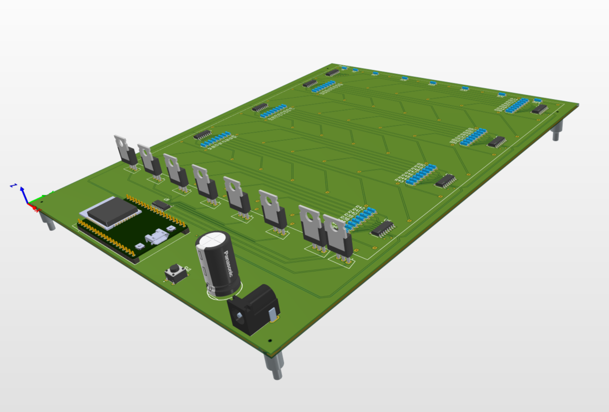
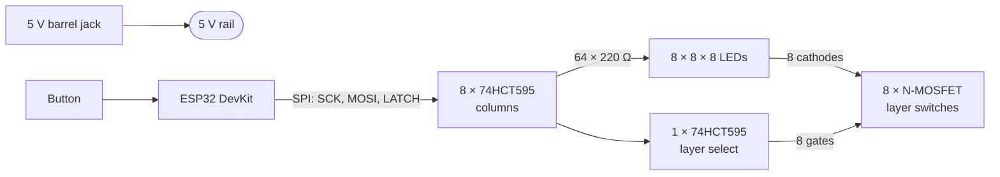

# 8×8×8 LED Cube

A 512-LED cube driven by an ESP32, designed from requirements to PCB as a personal project. Everything is documented the way a real product would be: requirements, measurable specifications, architecture, design decisions, risks and test plans.

**Status: design phase.** Schematic and PCB layout are done in Altium. The board has not been ordered or built yet, and the firmware has not been started.

## How it works

One horizontal layer of 64 LEDs is lit at a time. The ESP32 shifts 72 bits into a chain of nine 74HCT595 shift registers over SPI: 64 bits for the columns and 8 for the layer select. A single latch edge updates both together, so new column data never appears on the old layer. Eight layers make one frame, refreshed 200 times a second.

## Key figures

| | |
|---|---|
| LEDs | 512, blue diffused 5 mm, 22.86 mm (900 mil) pitch |
| Controller | ESP32 DevKit on headers, reflashable over USB |
| Drivers | 9 × 74HCT595 (64 columns + 8 layers), 8 × IRLB3813 MOSFETs |
| Refresh | 200 Hz full frame, 1/8 duty per layer |
| Supply | 5 V, ≤ 700 mA from a single mains adapter |
| PCB | 2-layer FR-4, 1.6 mm, 180 × 230 mm; top pour +5 V, bottom pour GND |
| Budget | ≤ 100 EUR in parts |

## Progress

- [x] User requirements (22) and measurable specifications (34)
- [x] System architecture and interface definitions
- [x] 21 design decision records (ADRs)
- [x] Power budget and pin budget
- [x] Risk register
- [x] Schematic and PCB layout (Altium Designer)
- [x] DC power integrity analysis (Altium Power Analyzer by Keysight)
- [x] Integration, system and acceptance test plans
- [ ] Measure LED forward voltage and confirm the column resistor value
- [ ] Breadboard test: one shift register, one MOSFET, eight LEDs
- [ ] Order PCB
- [ ] Build the lattice and assemble
- [ ] Firmware: refresh loop, button handling, five animations
- [ ] Run the system and acceptance tests

## Documentation

| Document | What's in it |
|---|---|
| [requirements.md](docs/requirements.md) | What the cube must do, from the user's point of view |
| [system-specifications.md](docs/system-specifications.md) | Each requirement as a number with a tolerance |
| [architecture.md](docs/architecture.md) | Block diagram, interfaces and timing |
| [decisions.md](docs/decisions.md) | Why each design choice was made, with the options rejected |
| [power-budget.md](docs/power-budget.md) | Current and heat for every block |
| [power-integrity.md](docs/power-integrity.md) | DC drop analysis of the 5 V network |
| [pin-budget.md](docs/pin-budget.md) | ESP32 pin assignment |
| [risks.md](docs/risks.md) | What could go wrong and how it is mitigated |
| [traceability.md](docs/traceability.md) | Requirement → specification → test mapping |
| [integration-test-plan.md](docs/integration-test-plan.md), [system-test-plan.md](docs/system-test-plan.md), [acceptance-plan.md](docs/acceptance-plan.md) | How each specification will be verified |

The Altium project (schematic, PCB, libraries, BOM) is in [`hardware/led-cube`](hardware/led-cube).

## Author

Nikita Juscenko, Electrical & Electronic Engineering student at Saxion University of Applied Sciences.
[LinkedIn](https://www.linkedin.com/in/nikita-juscenko)
